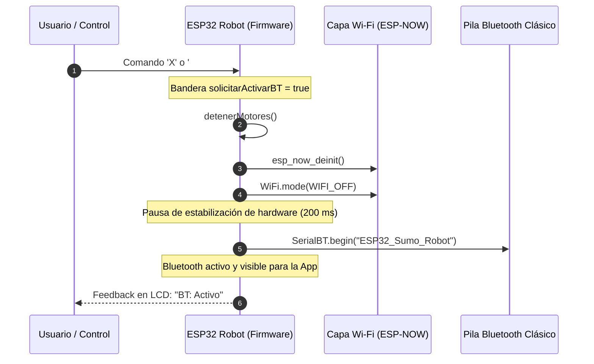
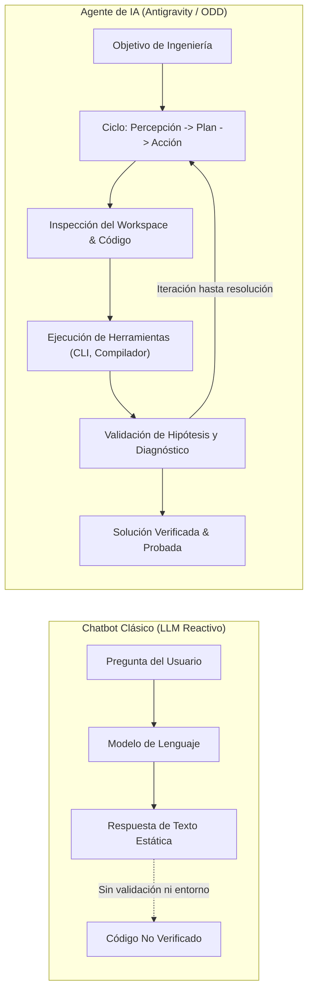
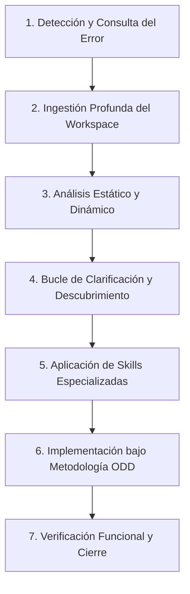

# Robot Sumo 2WD Autónomo y Teledirigido con Ecosistema de Agentes de IA

<p align="center">
  
  
  
  
  
  
</p>

<p align="center">
  
  
  
</p>

---

## 1. Integrantes del Proyecto

| Nombre Completo | Rol Principal en el Proyecto |
| :--- | :--- |
| **Cerron Melgar, Kevin** | Diseño de App Móvil (MIT App Inventor) y Pruebas de Integración |
| **Yauri Pipa, Julio Alfredo** | Algoritmos de Combate Autónomo y Control de Tracción |
| **Berrocal Casanca, Andre Esau** | Hardware, Ensamble Mecánico y Cableado de Potencia |
| **Landeo Aucapiña, Paul Angelo** | Arquitectura de Firmware, ESP-NOW y Conmutación RF |
| **Tacas Cardenas, Andrea** | Validación de Sensores, Simulación Wokwi y Documentación |

---

## 2. Descripción General del Sistema

Este proyecto implementa una plataforma robótica de combate de categoría **Robot Sumo 2WD**, diseñada con arquitectura dual de microcontroladores **ESP32** para proporcionar máxima flexibilidad en competencias:
1. **Control Remoto Directo por Teclado Matricial**: Transmisión inalámbrica de ultra baja latencia punto a punto mediante **ESP-NOW**.
2. **Control Remoto por Aplicación Móvil Android**: Interfaz gráfica Bluetooth desarrollada en **MIT App Inventor** (`RobotSumoV2.aia.zip`).
3. **Modo Autónomo de Combate**: Búsqueda reactiva mediante barrido rotatorio y detección por ultrasonido (**HC-SR04**), ejecutando maniobras de embestida a máxima potencia al localizar al oponente a menos de 30 cm.
4. **Conmutación Dinámica de Radio (RF Switching)**: Capacidad en caliente para apagar la pila Wi-Fi/ESP-NOW y encender la pila Bluetooth Clásico sin colisión de hardware en el módem compartido de 2.4 GHz.

```mermaid
flowchart TD
    subgraph Emisor["Dispositivo de Control Remoto (ESP32 #2)"]
        Keypad["Teclado Matricial 4x4"] -->|Lectura de pulsaciones| ESP32_TX["ESP32 Transmisor"]
        ESP32_TX -->|ESP-NOW Frame (Ultra Baja Latencia)| AntenaTX["Radio 2.4 GHz"]
    end

    subgraph AppMovil["Dispositivo Móvil Android"]
        App["MIT App Inventor (RobotSumoV2)"] -->|Bluetooth Serial SPP| AntenaBT["Bluetooth App"]
    end

    subgraph Receptor["Robot Sumo 2WD (ESP32 #1)"]
        AntenaRX["Radio 2.4 GHz Receptor"] --> ESP32_RX["ESP32 Controlador Principal"]
        AntenaBT -.->|Comandos 'F','B','L','R','S'| ESP32_RX
        
        ESP32_RX -->|PWM Inversión de Giro| L9110S["Puente H L9110S"]
        L9110S --> Motores["2x Motores DC con Ruedas de Goma"]
        
        SensorUS["Sensor HC-SR04"] -->|Eco de Distancia| ESP32_RX
        ESP32_RX -->|I2C Data / Clock| LCD["Pantalla LCD 1602 I2C (0x27)"]
        ESP32_RX -->|Señales GPIO / PWM| LED_RGB["LED Indicador RGB"]
    end

    AntenaTX ==>|Comandos de Modo y Tracción| AntenaRX
```

---

## 3. Estructura del Repositorio y Módulos

El repositorio se encuentra organizado en módulos desacoplados para firmware, aplicación móvil y simulación:

```
robot_sumo_usando_agenteS_de_ia/
├── README.md                                      <- Documentación general del sistema
├── diagram.json                                   <- Esquema de simulación para Wokwi (1x ESP32)
├── libraries.txt                                  <- Dependencias de librerías para Wokwi
├── sketch.ino                                     <- Firmware histórico simplificado para Wokwi
├── firmware/
│   ├── control_remoto/
│   │   ├── control_remoto.ino                     <- Firmware emisor ESP-NOW con teclado 4x4
│   │   └── README.md                              <- Documentación bloque por bloque y diagrama de flujo
│   └── robot_sumo/
│       ├── robot_sumo.ino                         <- Firmware receptor, L9110S, HC-SR04 y Bluetooth
│       └── README.md                              <- Documentación bloque por bloque y diagrama de flujo
└── app/
    ├── RobotSumoV2.aia.zip                        <- Archivo comprimido original de MIT App Inventor
    ├── youngandroidproject/project.properties     <- Configuración del proyecto móvil
    ├── src/appinventor/ai_kevin/RobotSumoV2/      <- Bloques funcionales (.bky) e interfaz (.scm)
    ├── assets/                                    <- Iconos y capturas de la aplicación
    └── README.md                                  <- Documentación de la app móvil y protocolo SPP
```

| Módulo / Subsistema | Código Fuente | Documentación Técnica Detallada |
| :--- | :--- | :--- |
| **Control Remoto (Transmisor ESP-NOW)** | [`control_remoto.ino`](file:///home/paul/Documents/workfiles/robot_sumo_usando_agenteS_de_ia/firmware/control_remoto/control_remoto.ino) | [README Control Remoto](file:///home/paul/Documents/workfiles/robot_sumo_usando_agenteS_de_ia/firmware/control_remoto/README.md) |
| **Robot Sumo (Receptor y Combate)** | [`robot_sumo.ino`](file:///home/paul/Documents/workfiles/robot_sumo_usando_agenteS_de_ia/firmware/robot_sumo/robot_sumo.ino) | [README Robot Sumo](file:///home/paul/Documents/workfiles/robot_sumo_usando_agenteS_de_ia/firmware/robot_sumo/README.md) |
| **App Móvil (MIT App Inventor)** | Directorio [`app/`](file:///home/paul/Documents/workfiles/robot_sumo_usando_agenteS_de_ia/app/) | [README Aplicación Móvil](file:///home/paul/Documents/workfiles/robot_sumo_usando_agenteS_de_ia/app/README.md) |

---

## 4. Arquitectura de Hardware y Mapeo de Conexiones

### 4.1. Microcontrolador Receptor (Robot Sumo)

El vehículo utiliza un controlador **ESP32 DevKitC V4** conectado a periféricos de sensado, tracción y telemetría visual:

| Periférico / Componente | Señal / Función | Pin GPIO (ESP32) | Notas de Diseño |
| :--- | :--- | :---: | :--- |
| **Driver Puente H L9110S** | Motor A (Terminal A) | **GPIO 27** | Señal PWM de avance/retroceso motor izquierdo |
| | Motor A (Terminal B) | **GPIO 26** | Control de dirección motor izquierdo |
| | Motor B (Terminal A) | **GPIO 25** | Señal PWM de avance/retroceso motor derecho |
| | Motor B (Terminal B) | **GPIO 33** | Control de dirección motor derecho |
| **Sensor Ultrasónico HC-SR04** | Disparo (TRIG) | **GPIO 5** | Pulso de disparo de 10 $\mu\text{s}$ |
| | Recepción (ECHO) | **GPIO 18** | Medición de ancho de pulso (retardo máx. 25 ms) |
| **LED RGB (Estado)** | Canal Rojo (R) | **GPIO 15** | Indicador de Modo Autónomo / Alerta |
| | Canal Verde (G) | **GPIO 2** | Indicador de Enlace / Estado operativo |
| | Canal Azul (B) | **GPIO 4** | Indicador de Modo Manual / Bluetooth activo |
| **Pantalla LCD 1602 I2C** | Línea de Datos (SDA) | **GPIO 21** | Bus serie de datos I2C (Pull-up integrada) |
| | Línea de Reloj (SCL) | **GPIO 22** | Bus de reloj I2C (Dirección fija `0x27`) |

### 3.2. Microcontrolador Emisor (Mando de Control Remoto ESP-NOW)

El mando a distancia utiliza un teclado matricial de membrana de 16 teclas (4x4):

| Teclado 4x4 | Conexión Física | Pin GPIO (ESP32) | Rol en Firmware |
| :--- | :---: | :---: | :--- |
| **Fila 1 (R1)** | Pin 1 Teclado | **GPIO 13** | Escaneo secuencial de filas |
| **Fila 2 (R2)** | Pin 2 Teclado | **GPIO 12** | Escaneo secuencial de filas |
| **Fila 3 (R3)** | Pin 3 Teclado | **GPIO 14** | Escaneo secuencial de filas |
| **Fila 4 (R4)** | Pin 4 Teclado | **GPIO 27** | Escaneo secuencial de filas |
| **Columna 1 (C1)** | Pin 5 Teclado | **GPIO 26** | Entrada digital con lectura directa |
| **Columna 2 (C2)** | Pin 6 Teclado | **GPIO 25** | Entrada digital con lectura directa |
| **Columna 3 (C3)** | Pin 7 Teclado | **GPIO 33** | Entrada digital con lectura directa |
| **Columna 4 (C4)** | Pin 8 Teclado | **GPIO 32** | Entrada digital con lectura directa |

---

## 4. Lógica de Control, Modos y Protocolo de Comunicación

### 4.1. Mapeo de Teclas del Control Remoto

El mando traduce las pulsaciones a códigos de comando unificados enviados vía ESP-NOW a la dirección MAC del robot (`D4:E9:F4:E2:F1:24`):

| Tecla Pulsada | Comando Enviado | Acción Resultante en el Robot |
| :---: | :---: | :--- |
| **'2'** | `'F'` | **Adelante**: Motores izquierdo y derecho avanzan a PWM 230 |
| **'8'** | `'B'` | **Atrás**: Motores izquierdo y derecho retroceden a PWM 230 |
| **'4'** | `'L'` | **Giro Izquierda**: Pivote rápido (Motor der. adelante, motor izq. atrás) |
| **'6'** | `'R'` | **Giro Derecha**: Pivote rápido (Motor izq. adelante, motor der. atrás) |
| **'5'** / **'0'** | `'S'` | **Detener**: Freno estático de motores (PWM 0) |
| **'A'** | `'A'` | **Cambio a Modo Manual**: Apaga modo autónomo, LED enciende Azul |
| **'B'** | `'X'` | **Cambio a Modo Autónomo + Activación BT**: LED enciende Rojo |
| **'C'** | `'C'` | **Habilitación de Movimiento**: Confirmación de arranque |
| **'#'** | `'#'` | **Activación Directa de Bluetooth en Modo Manual** |

### 4.2. Estrategia de Coexistencia RF (ESP-NOW vs. Bluetooth)

> [!IMPORTANT]
> El ESP32 cuenta con un único transceptor de radiofrecuencia de 2.4 GHz compartido entre Wi-Fi y Bluetooth. Activar ambos módulos simultáneamente sin una gestión estricta de tiempo compartido (*time-slicing*) puede provocar desbordamientos de memoria de pila (*heap exhaustion*), latencias inaceptables en combate o congelamiento del módem de radio.

Para solucionar este desafío de forma robusta, el firmware del robot implementa una **transición de antena atómica**:



### 4.3. Máquina de Estados del Modo Autónomo

En el Modo Autónomo, el robot evalúa continuamente la distancia frente a sí mediante el sensor ultrasónico:
- **Distancia < 30 cm**: Se detecta al adversario en la trayectoria. Se imprime `EMBESTIDA!` en la pantalla LCD y se acciona la tracción a máxima potencia (`PWM = 255`).
- **Distancia $\ge$ 30 cm o Fuera de Rango**: Se activa la rutina de rastreo. El robot rota sobre su propio eje a velocidad media (`PWM = 140`) barriendo el dohyo hasta interceptar al oponente.
- **Interrupción de Seguridad**: Cualquier comando manual recibido desde la App Bluetooth ('F', 'B', 'L', 'R', 'S') aborta instantáneamente el modo autónomo y conmuta al modo manual.

---

## 5. Aplicación Móvil (MIT App Inventor)

El archivo [`RobotSumoV2.aia.zip`](file:///home/paul/Documents/workfiles/robot_sumo_usando_agenteS_de_ia/RobotSumoV2.aia.zip) contiene el proyecto completo de MIT App Inventor.

### Características de la App:
- **Selector de Lista Bluetooth**: Escaneo y emparejamiento con el dispositivo `ESP32_Sumo_Robot`.
- **Pad Direccional Táctil**: Botones de interfaz para enviar caracteres de control por puerto serie Bluetooth (`F` para avanzar, `B` para retroceder, `L` para virar a la izquierda, `R` para virar a la derecha y `S` para detener).
- **Consola de Estado**: Notificación visual del estado de enlace y comandos despachados.

---

## 6. Ingeniería Asistida por Agentes de IA y Metodología ODD

El desarrollo, depuración y estabilización de este sistema de robótica embebida se realizó mediante el uso activo de **Agentes de Inteligencia Artificial** basados en modelos de lenguaje y razonamiento de última generación, incluyendo **Google Antigravity**, **OpenCode** y **Codex**.

### 6.1. ¿Qué es un Agente de IA y en qué se diferencia de un Chatbot Tradicional?

Un error conceptual frecuente en la ingeniería actual es equiparar un **Agente de IA** con un **Chatbot conversacional estándar**:



| Criterio | Chatbot Tradicional (Asistente Reactivo) | Agente de IA Autónomo (p. ej. Antigravity) |
| :--- | :--- | :--- |
| **Naturaleza Operativa** | Pasiva y reactiva: se limita a predecir texto token por token en función del último mensaje. | Activa y orientada a metas (*Goal-Driven*): ejecuta un bucle continuo de planificación, acción y verificación. |
| **Acceso al Entorno** | Ninguno. Está confinado estrictamente a su ventana de chat. | Pleno acceso a herramientas del sistema: lectura de archivos, ejecución en terminal (`bash`), inspección de dependencias y pruebas. |
| **Comprensión del Contexto** | Memoria volátil limitada al prompt inmediato; susceptible a alucinaciones sintácticas. | Ingestión estructurada del repositorio entero, comprensión de esquemas JSON de hardware, temporizaciones y arquitectura física. |
| **Garantía de Calidad** | Asume que el código funciona sin probarlo; complaciente (*sycophantic*). | Verifica hipótesis antes de responder; refuta propuestas técnicamente inviables (*Zero Sycophancy*). |

---

### 6.2. Flujo de Trabajo Sistemático de Resolución de Problemas

Durante el ciclo de vida del firmware del robot sumo, la detección y corrección de incidencias siguió un protocolo riguroso:



1. **Detección y Consulta del Error**:
   El desarrollador reporta los síntomas observados en hardware o simulación (por ejemplo, desconexiones intermitentes de ESP-NOW al activar Bluetooth, lecturas anómalas de `pulseIn` en el sensor ultrasónico o bloqueos del bus I2C).
2. **Ingestión Profunda del Workspace**:
   El agente no opera sobre fragmentos aislados; lee el árbol completo de directorios, examinando el esquema de hardware ([`diagram.json`](file:///home/paul/Documents/workfiles/robot_sumo_usando_agenteS_de_ia/diagram.json)), las dependencias de librerías ([`libraries.txt`](file:///home/paul/Documents/workfiles/robot_sumo_usando_agenteS_de_ia/libraries.txt)) y el código del firmware ([`sketch.ino`](file:///home/paul/Documents/workfiles/robot_sumo_usando_agenteS_de_ia/sketch.ino)).
3. **Análisis Estático y Dinámico de Código**:
   Se efectúa una auditoría de recursos: comprobación de conflictos entre pines analógicos del ADC2 (los cuales se inhabilitan cuando el Wi-Fi está encendido en el ESP32), asignación de temporizadores PWM y cálculo de consumo de corriente teórico.
4. **Bucle de Clarificación y Preguntas de Contexto**:
   El agente formula preguntas estratégicas de ingeniería antes de escribir código: ¿cuál es la frecuencia requerida de refresco del sensor ultrasónico?, ¿qué comportamiento debe tener el robot si pierde la señal de control? Esto evita parches superficiales y asegura un diseño coherente.
5. **Uso de Skills Especializadas**:
   Se aplican capacidades integradas del agente para tareas críticas:
   - *Cognitive Doc Design*: Estructuración de documentos técnicos reduciendo la carga cognitiva.
   - *Architecture & Flow Inspection*: Modelado de diagramas de secuencia para verificar estados libres de bloqueos (*deadlocks*).
6. **Metodología ODD (Organic Driven Development)**:
   - **Desarrollo Guiado por Especificaciones**: Cada función se diseña como una unidad modular testeable.
   - **Construcción en Capas Orgánicas**: Primero se verifica la capa física (pines y direccionamiento I2C), luego la capa de transporte (ESP-NOW/BT) y finalmente la capa de aplicación (lógica de combate).
   - **Entrega Incremental sin Regresiones**: Cada cambio cuenta con validación previa de impacto sobre el resto del ecosistema.

---

### 6.3. El Potencial de los Agentes de IA en la Educación y el Aprendizaje

La integración de agentes autónomos en la formación técnica marca un cambio de paradigma pedagógico:

1. **Andamiaje Cognitivo Personalizado (*Cognitive Scaffolding*)**:
   A diferencia de un buscador o de un modelo genérico que entrega una respuesta copiada, el agente actúa como un **Arquitecto Senior**: descompone problemas multidisciplinarios (mecánicos, electrónicos y de software) en conceptos digeribles, permitiendo que el estudiante comprenda el principio físico detrás de cada línea de código.
2. **Cero Complacencia y Desarrollo del Rigor Técnico (*Zero Sycophancy*)**:
   El agente confronta decisiones de diseño incorrectas (por ejemplo, intentar usar pines restringidos por el bootloader o bloquear el loop principal con retardos síncronos `delay()` extensos), explicando la razón técnica y promoviendo el pensamiento crítico.
3. **Evolución: De Codificadores Pasivos a Arquitectos de Sistemas**:
   El estudiante deja de memorizar sintaxis para concentrarse en la arquitectura de alto nivel, la gestión de interfaces y el análisis de tolerancias en sistemas ciberfísicos complejos.

---

## 7. Guía de Ejecución y Simulación

### 7.1. Simulación en Wokwi
1. Abrir el entorno [Wokwi para VS Code](https://wokwi.com/) o la plataforma web.
2. Cargar el archivo de conexión física [`diagram.json`](file:///home/paul/Documents/workfiles/robot_sumo_usando_agenteS_de_ia/diagram.json).
3. Asegurar que las librerías `LiquidCrystal_I2C` y `Keypad` estén registradas en [`libraries.txt`](file:///home/paul/Documents/workfiles/robot_sumo_usando_agenteS_de_ia/libraries.txt).
4. Iniciar la simulación y presionar las teclas en el teclado matricial para verificar la respuesta de los motores en pantalla y consola serial.

### 7.2. Carga en Hardware Físico
1. En el **IDE de Arduino** o **PlatformIO**, seleccionar la placa **ESP32 Dev Module**.
2. Instalar las dependencias requeridas mediante el Gestor de Bibliotecas:
   - `LiquidCrystal_I2C` by Frank de Brabander.
   - `Keypad` by Mark Stanley.
   - Soporte nativo de `BluetoothSerial`, `WiFi` y `esp_now` (incluidas en el core ESP32).
3. Compilar y flashear el código del emisor en el microcontrolador del mando y el código del receptor en el microcontrolador del robot.
4. Para emparejar con la aplicación móvil, instalar el APK compilado desde [`RobotSumoV2.aia.zip`](file:///home/paul/Documents/workfiles/robot_sumo_usando_agenteS_de_ia/RobotSumoV2.aia.zip) y vincular con el dispositivo `ESP32_Sumo_Robot`.
