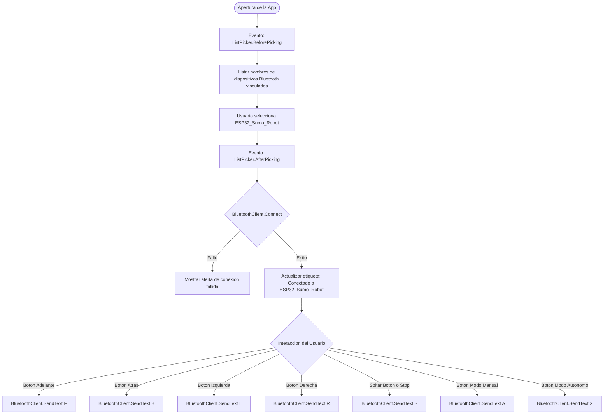

# Documentación: Aplicación Móvil Android (MIT App Inventor)

Este directorio contiene el proyecto fuente de la aplicación móvil de control desarrollada en **MIT App Inventor 2** para comandar el Robot Sumo 2WD mediante Bluetooth Clásico (SPP).

---

## 1. Estructura del Directorio `app/`

```
app/
├── youngandroidproject/
│   └── project.properties                  <- Configuración del proyecto MIT App Inventor
├── src/appinventor/ai_kevin/RobotSumoV2/
│   ├── Screen1.bky                         <- Código gráfico por bloques (Lógica funcional en XML)
│   └── Screen1.scm                         <- Definición de componentes visuales de la interfaz (JSON)
├── assets/                                 <- Recursos gráficos, iconos y fondos de la app
│   ├── app1.png, app2.png, app3.png        <- Capturas y recursos de interfaz
│   ├── 11011010.svg, 11011010.png         <- Iconos de la aplicación
│   └── 20-removebg-preview.png             <- Elementos gráficos transparentes
└── README.md                               <- Esta documentación técnica
```

---

## 2. Diagrama de Flujo de la Interfaz Móvil



---

## 3. Protocolo de Comandos Transmitidos

La aplicación envía cadenas de texto de un solo carácter por el socket Bluetooth SPP al ESP32:

| Botón / Evento en App | Carácter Enviado | Acción Provocada en el ESP32 |
| :--- | :---: | :--- |
| **Flecha Arriba (Adelante)** | `'F'` | Tracción frontal en ambos motores (`PWM 230`) |
| **Flecha Abajo (Atrás)** | `'B'` | Tracción reversa en ambos motores (`PWM 230`) |
| **Flecha Izquierda** | `'L'` | Giro en pivote a la izquierda (`PWM 200`) |
| **Flecha Derecha** | `'R'` | Giro en pivote a la derecha (`PWM 200`) |
| **Botón STOP / Al soltar** | `'S'` | Detención inmediata de ambos motores (`PWM 0`) |
| **Botón Modo Manual** | `'A'` | Retorno a control manual directo |
| **Botón Modo Autónomo** | `'X'` | Activación del algoritmo de combate ultrasónico |

---

## 4. Cómo Importar y Modificar el Proyecto en MIT App Inventor

1. Ingresar a [MIT App Inventor](https://ai2.appinventor.mit.edu/).
2. Ir al menú superior: **Projects $\rightarrow$ Import project (.aia) from my computer**.
3. Seleccionar el archivo empaquetado [`RobotSumoV2.aia.zip`](file:///home/paul/Documents/workfiles/robot_sumo_usando_agenteS_de_ia/app/RobotSumoV2.aia.zip) (o renombrado a `.aia`).
4. Para compilar la aplicación en formato instalable para teléfonos Android, dirigirse a **Build $\rightarrow$ Android App (.apk)**.
