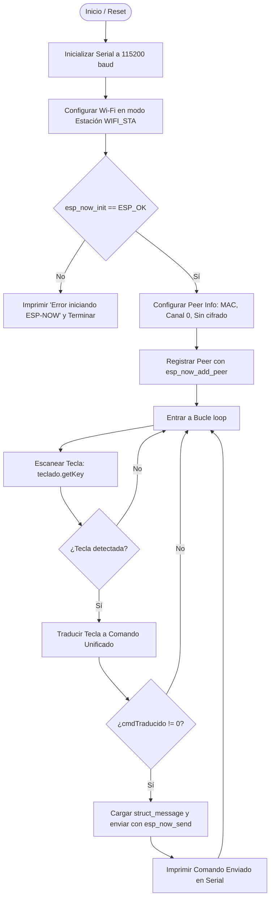

# Documentación Técnica: Firmware de Control Remoto (ESP-NOW)

Este módulo implementa el firmware del transmisor manual basado en **ESP32 DevKitC V4** y un **teclado matricial 4x4**, comunicándose mediante el protocolo de radiofrecuencia de ultra baja latencia **ESP-NOW**.

---

## 1. Diagrama de Flujo del Firmware



---

## 2. Explicación Bloque por Bloque del Código

### Bloque 1: Inclusión de Librerías y Definiciones de Red
```cpp
#include <esp_now.h>
#include <WiFi.h>
#include <Keypad.h>

uint8_t macRobot[] = {0xD4, 0xE9, 0xF4, 0xE2, 0xF1, 0x24};
```
- **`esp_now.h`**: Proporciona las primitivas de comunicación para el protocolo sin conexión desarrollado por Espressif, operando en la capa de enlace de datos (MAC) de 2.4 GHz.
- **`WiFi.h`**: Necesario para inicializar el subsistema de radio del ESP32 en modo estación (`WIFI_STA`), requisito previo obligatorio para que la interfaz ESP-NOW pueda operar.
- **`Keypad.h`**: Librería optimizada para la gestión no bloqueante de matrices de pulsadores mediante multiplexación de pines.
- **`macRobot`**: Vector de 6 bytes con la dirección MAC física del adaptador Wi-Fi del ESP32 receptor (Robot Sumo).

---

### Bloque 2: Matriz del Teclado y Mapeo de Pines
```cpp
const byte FILAS = 4;
const byte COLUMNAS = 4;
char teclas[FILAS][COLUMNAS] = {
  {'1', '2', '3', 'A'}, // '2'=Adelante, 'A'=Modo Manual
  {'4', '5', '6', 'B'}, // '4'=Izq, '5'=Stop, '6'=Der, 'B'=Automático + Activar BT
  {'7', '8', '9', 'C'}, // '8'=Atrás, 'C'=Habilitar/Arrancar movimiento
  {'*', '0', '#', 'D'}  // '#'=Activar BT directo en Modo Manual
};

byte pinesFilas[FILAS] = {13, 12, 14, 27};
byte pinesColumnas[COLUMNAS] = {26, 25, 33, 32};

Keypad teclado = Keypad(makeKeymap(teclas), pinesFilas, pinesColumnas, FILAS, COLUMNAS);
```
- Define la disposición física de la membrana 4x4.
- Asigna los pines GPIO de las filas como salidas secuenciales con nivel bajo activo y las columnas como entradas con resistencia *pull-up* interna.

---

### Bloque 3: Estructura de Datos del Payload
```cpp
typedef struct struct_message {
  char comando;
} struct_message;

struct_message datosEnviar;
esp_now_peer_info_t peerInfo;
```
- **`struct_message`**: Estructura de datos idéntica en emisor y receptor. Contiene un único carácter (`char`), minimizando el tamaño del paquete a 1 byte de carga útil para garantizar tiempos de transmisión inferiores a 2 milisegundos.
- **`peerInfo`**: Estructura del SDK de Espressif que almacena los metadatos de emparejamiento (dirección MAC, canal de radio y configuración de cifrado).

---

### Bloque 4: Inicialización (`setup`)
```cpp
void setup() {
  Serial.begin(115200);
  WiFi.mode(WIFI_STA);

  if (esp_now_init() != ESP_OK) {
    Serial.println("Error iniciando ESP-NOW");
    return;
  }

  memcpy(peerInfo.peer_addr, macRobot, 6);
  peerInfo.channel = 0;  
  peerInfo.encrypt = false;
  esp_now_add_peer(&peerInfo);

  Serial.println("Control ESP-NOW listo.");
}
```
1. Inicia la comunicación serie a 115200 baudios para diagnóstico.
2. Pone la radio en modo `WIFI_STA` sin conectarse a ningún punto de acceso.
3. Inicializa la pila ESP-NOW y valida el estado de retorno (`ESP_OK`).
4. Configura el peer del robot: copia la dirección MAC destino, establece el canal 0 (canal actual) y desactiva el cifrado para reducir la sobrecarga de procesamiento en tiempo real.
5. Registra el peer mediante `esp_now_add_peer(&peerInfo)`.

---

### Bloque 5: Ciclo de Escaneo y Despacho (`loop`)
```cpp
void loop() {
  char tecla = teclado.getKey();

  if (tecla) {
    char cmdTraducido = 0;
    switch (tecla) {
      case '2': cmdTraducido = 'F'; break; // Adelante
      case '8': cmdTraducido = 'B'; break; // Atrás
      case '4': cmdTraducido = 'L'; break; // Izquierda
      case '6': cmdTraducido = 'R'; break; // Derecha
      case '5': 
      case '0': cmdTraducido = 'S'; break; // Detener
      case 'A': cmdTraducido = 'A'; break; // Modo Manual
      case 'B': cmdTraducido = 'X'; break; // Automático + BT
      case 'C': cmdTraducido = 'C'; break; // Habilitar movimiento del robot
      case '#': cmdTraducido = '#'; break; // Activar BT directo
    }

    if (cmdTraducido != 0) {
      datosEnviar.comando = cmdTraducido;
      esp_now_send(macRobot, (uint8_t *) &datosEnviar, sizeof(datosEnviar));
      Serial.print("Comando enviado: ");
      Serial.println(cmdTraducido);
    }
  }
}
```
- **`teclado.getKey()`**: Método no bloqueante que consulta el estado matricial. Retorna `0` si ninguna tecla fue presionada o el carácter de la tecla recién pulsada.
- **Traducción de Caracteres**: Transforma la tecla física en un código de comando normalizado (`F`, `B`, `L`, `R`, `S`, `A`, `X`, `C`, `#`).
- **`esp_now_send`**: Despacha el paquete de datos directamente al robot. La llamada es asíncrona a nivel de hardware, asegurando que el bucle de control no sufra retardos perjudiciales.
