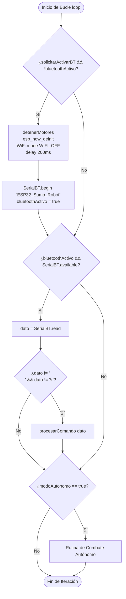
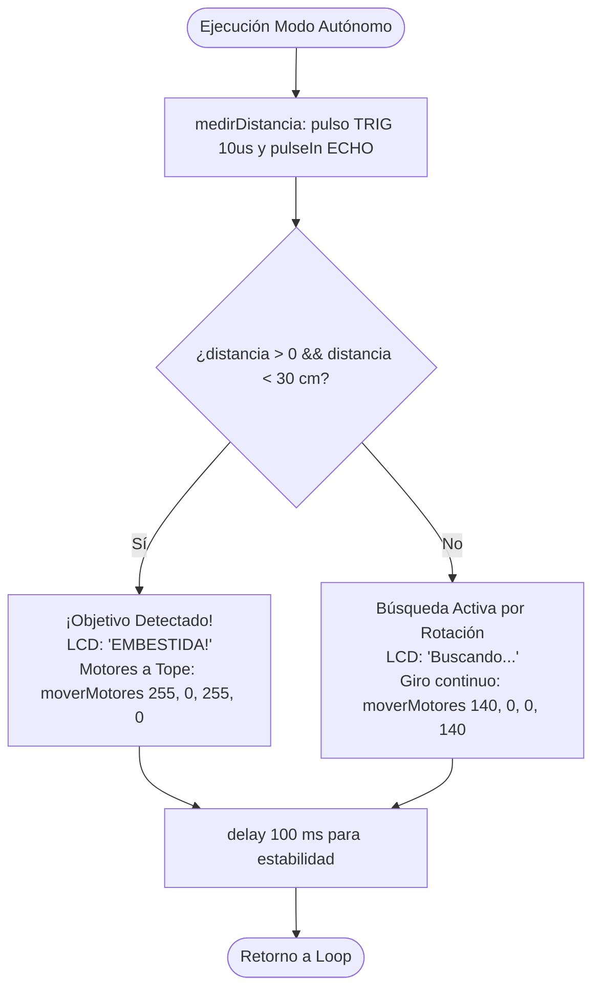

# Documentación Técnica: Firmware del Robot Sumo (Receptor, Actuadores y Modo Autónomo)

Este documento detalla la arquitectura, el flujo de ejecución y el análisis bloque a bloque del firmware principal del Robot Sumo 2WD, implementado en un microcontrolador **ESP32 DevKitC V4**.

---

## 1. Diagramas de Flujo del Firmware

### 1.1. Bucle Principal (`loop`) y Conmutación de Antenas



### 1.2. Rutina de Combate Autónomo



---

## 2. Explicación Bloque por Bloque del Código

### Bloque 1: Inclusión de Librerías y Definición de Pines
```cpp
#include <esp_now.h>
#include <WiFi.h>
#include <Wire.h>
#include <LiquidCrystal_I2C.h>
#include "BluetoothSerial.h"

// Pines Puente H L9110S
#define MOTOR_A_A 27
#define MOTOR_A_B 26
#define MOTOR_B_A 25
#define MOTOR_B_B 33

// Pines Sensor HC-SR04 y LED RGB
#define TRIG_PIN 5
#define ECHO_PIN 18
#define LED_R 15
#define LED_G 2
#define LED_B 4
```
- **Librerías de Comunicación**: `esp_now.h` y `WiFi.h` gestionan la recepción inicial; `BluetoothSerial.h` proporciona el puerto serie virtual emulado sobre Bluetooth SPP.
- **I2C y Display**: `Wire.h` y `LiquidCrystal_I2C.h` controlan la pantalla LCD 1602 en la dirección I2C `0x27`.
- **Puente H L9110S**: 4 canales digitales/PWM dedicados al accionamiento bidireccional de los motores izquierdo (Motor A) y derecho (Motor B).
- **HC-SR04 & RGB**: Pines dedicados para el transductor ultrasónico y los 3 canales de color del LED de estado.

---

### Bloque 2: Estructuras y Variables de Control de Estado
```cpp
LiquidCrystal_I2C lcd(0x27, 16, 2);
BluetoothSerial SerialBT;

typedef struct struct_message {
  char comando;
} struct_message;

struct_message datosRecibidos;

bool modoAutonomo = false;
bool solicitarActivarBT = false;
bool bluetoothActivo = false;
```
- `modoAutonomo`: Bandera que activa o desactiva la máquina de estados de combate por ultrasonido.
- `solicitarActivarBT`: Señalizador asíncrono para coordinar el apagado seguro de Wi-Fi y el arranque de Bluetooth sin interrumpir callbacks activos.
- `bluetoothActivo`: Registro de la radio actualmente en operación.

---

### Bloque 3: Despachador Unificado de Comandos (`procesarComando`)
```cpp
void procesarComando(char cmd) { ... }
```
Este método desacopla el origen físico del comando (sea ESP-NOW o Bluetooth) de la lógica de ejecución del robot:
- **`'A'`**: Fuerza el **Modo Manual**, detiene motores, actualiza el LCD a "Modo: Manual" y conmuta el LED RGB a Azul.
- **`'X'`**: Conmuta a **Modo Autónomo**, enciende el LED Rojo y levanta la bandera `solicitarActivarBT` si Bluetooth no estaba inicializado.
- **`'#'`**: Petición de encendido directo de Bluetooth conservando el Modo Manual.
- **`'F'`, `'B'`, `'L'`, `'R'`, `'S'`**: Comandos de movimiento manual. Si el robot se encontraba en modo autónomo, el comando manual actúa como **interrupción de seguridad inmediata**, cancelando el modo autónomo y transfiriendo el control al operador.

---

### Bloque 4: Callback de Recepción ESP-NOW (`OnDataRecv`)
```cpp
void OnDataRecv(const esp_now_recv_info_t * info, const uint8_t *incomingData, int len) {
  memcpy(&datosRecibidos, incomingData, sizeof(datosRecibidos));
  procesarComando(datosRecibidos.comando);
}
```
- Se ejecuta en el contexto de interrupción de la pila de red del ESP32 cuando arriba un paquete.
- Copia de manera segura el buffer recibido a la estructura local `datosRecibidos` y lo remite inmediatamente a `procesarComando()`.

---

### Bloque 5: Inicialización (`setup`)
```cpp
void setup() {
  // Configuración de pines de motor y sensores
  // Inicialización de LCD I2C y LED RGB
  // Configuración de Wi-Fi en modo WIFI_STA e inicio de ESP-NOW
}
```
1. Configura la velocidad serie a 115200 baudios.
2. Establece todos los pines de control del puente H y del sensor ultrasónico en sus modos correspondientes (`OUTPUT` / `INPUT`).
3. Inicializa el display LCD I2C con luz de fondo activada y mensaje inicial `"Robot Sumo Listo"`.
4. Enciende el LED en color azul y registra el callback `OnDataRecv` en la pila ESP-NOW.

---

### Bloque 6: Bucle Principal (`loop`)
El bucle ejecuta 3 tareas no bloqueantes:
1. **Transición Atómica de Hardware RF**: Si `solicitarActivarBT` es verdadero, apaga ESP-NOW con `esp_now_deinit()`, deshabilita el módem Wi-Fi con `WiFi.mode(WIFI_OFF)`, espera 200 ms de asentamiento y lanza `SerialBT.begin("ESP32_Sumo_Robot")`.
2. **Polling de Bluetooth Serial**: Si el Bluetooth está activo y hay bytes disponibles en el buffer (`SerialBT.available()`), los lee y procesa ignorando caracteres de control `\r` o `\n`.
3. **Máquina de Combate Autónomo**: Si `modoAutonomo == true`, efectúa una lectura de distancia. Si un objeto está entre 1 y 29 cm, aplica embestida con PWM 255 en ambos motores hacia adelante; si no hay detección, rota sobre su eje a PWM 140 para barrer el área.

---

### Bloque 7: Funciones de Control de Actuadores y Sensores
- **`ejecutarMovimientoManual(char cmd)`**: Traduce comandos direccionales a niveles PWM predefinidos (`F`: 230, `B`: 230, `L`: pivote 200, `R`: pivote 200, `S`: 0).
- **`moverMotores(int a1, int a2, int b1, int b2)`**: Aplica los valores analógicos a los 4 pines de control mediante `analogWrite()` del ESP32.
- **`medirDistancia()`**: Genera un pulso limpio de 10 $\mu\text{s}$ en `TRIG_PIN` y mide el tiempo de respuesta en `ECHO_PIN` con un timeout de 25000 $\mu\text{s}$ (aprox. 4 metros). Calcula la distancia en centímetros mediante la constante de velocidad del sonido ($0.034 / 2$). Retorna `999` si el pulso expira.
- **`setLED(int r, int g, int b)`**: Modula la intensidad de color del LED RGB mediante modulación por ancho de pulsos.
- **`actualizarLCD(String linea1, String linea2)`**: Limpia y refresca las dos líneas del display de 16 caracteres.
